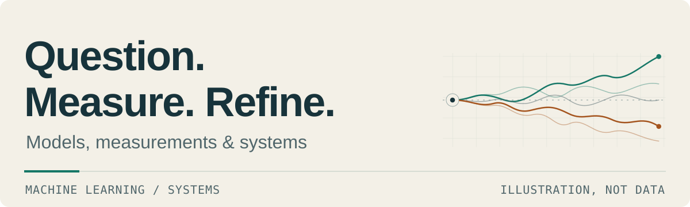

<picture>
  <source media="(prefers-color-scheme: dark)" srcset="assets/header-dark.svg">
  <source media="(prefers-color-scheme: light)" srcset="assets/header-light.svg">
  
</picture>

# Skyler Kendrick

My interests center on machine learning research and how machine learning can be applied to finance and medicine, where a result is only as good as the assumptions and measurements behind it. I care about accuracy, efficiency and clear code: assumptions stated, bottlenecks measured before they are optimized, and limits written down.

[Selected work](#selected-work) · [In development: Ringo and Ringo-IDE](#in-development)

## Selected work

Four projects, from numerical models through training pipelines and job coordination to practical scheduling.

### [quantmc](https://github.com/SkylerLK510/quantmc) · option pricing and risk

A Monte Carlo simulation engine for option pricing and risk, built from scratch in Python.

### [med-clip-profiling](https://github.com/SkylerLK510/med-clip-profiling) · training-pipeline efficiency

Profiling-driven optimization of a CLIP-style medical image/text training pipeline on a single GPU. Controlled measurements separate compute bottlenecks from decoding bottlenecks. It is pipeline research, not a model validated to a published retrieval metric.

### [personal-compute-lab](https://github.com/SkylerLK510/personal-compute-lab) · durable job coordination

An early, local-only Python/SQLite job coordinator with a durable queue, expiring leases, heartbeats and stale-result rejection. GPU inference, training, model sharding and large checkpoint transfer are future work.

### [berth-scheduler](https://github.com/SkylerLK510/berth-scheduler) · waterfront reservations

A reservation application for a marine-research waterfront: a monthly schedule, overlap and fit checks, spreadsheet import, public browsing and account-restricted writes.

## In development

### [Ringo](https://github.com/SkylerLK510/Ringo) · review and design harness

An in-development council-guided harness that runs existing provider models for repository-aware code review and design proposals. File revisions are marked ready for human review only when executable checks pass and a separate rubric-scoring council recommends them; nothing is applied automatically. Recent work adds hash-checked local releases that need a person's approval, HarBenchmark (twelve synthetic development cases) and a ReviewBench adapter. No HarBenchmark score, official ReviewBench result or quality gain is claimed, and Ringo's research reliability is not yet established.

### [Ringo-IDE](https://github.com/SkylerLK510/Ringo-IDE) · local code-suggestion research

Experimental research toward local code suggestions in an editor. A small code-model baseline and Stanford Hazy Research's Next-Concept Modeling (NCM) are planned behind one interface for comparison; the research finds that the released NCM tasks do not establish code completion. The scaffold in [open PR #1](https://github.com/SkylerLK510/Ringo-IDE/pull/1) has 25 offline tests and a demo that validates a fixed completion against the exact document snapshot and range. There is no editor UI, model inference or training yet, and the main branch holds only the license and a short README.
